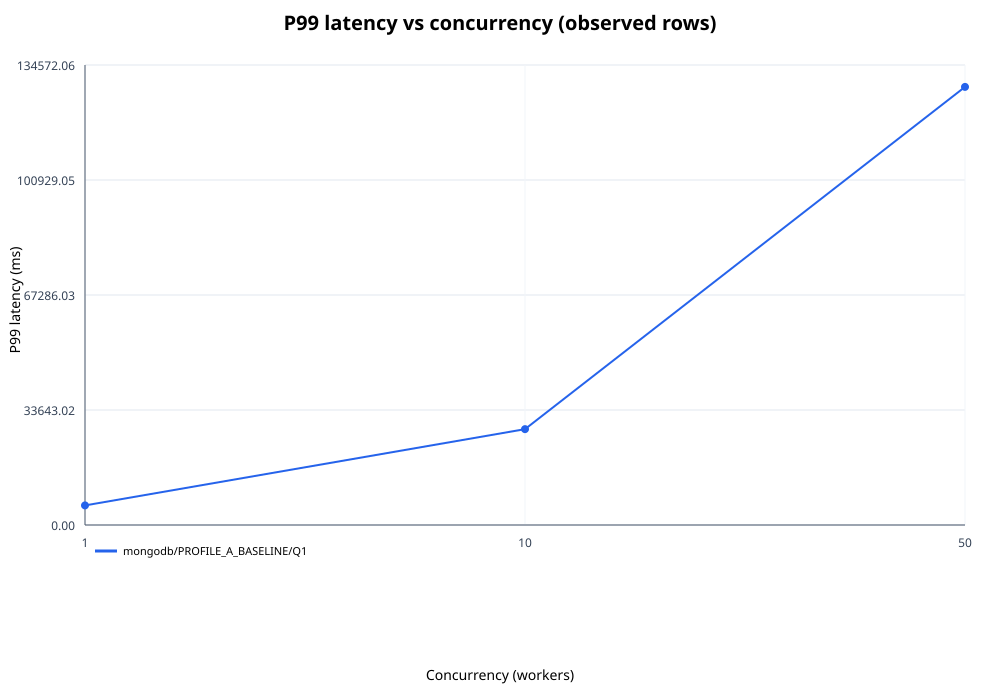
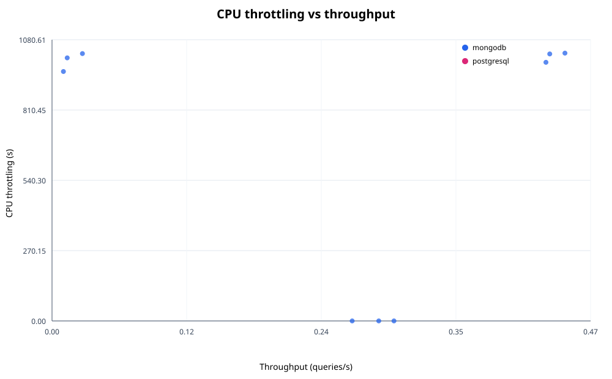
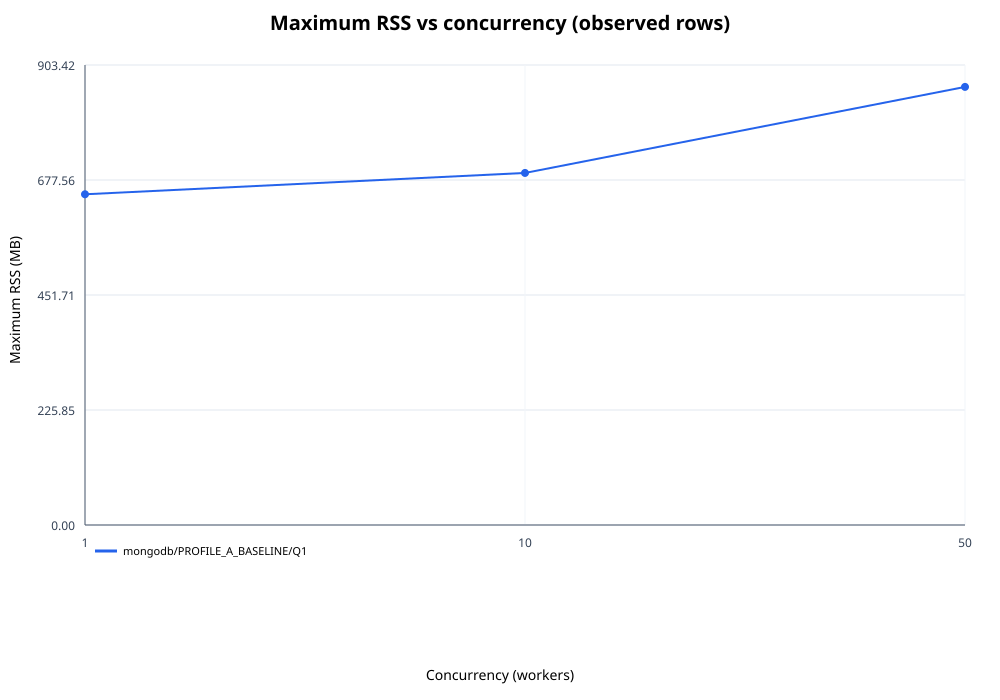

# AVANCE PRELIMINAR — INCOMPLETO, NO FINAL

## Informe de métricas: MongoDB frente a PostgreSQL JSONB
Fuente de datos: `matrix-final-20261101-autoflush.csv`. Filas validadas: **9 de 108**.

> **INCOMPLETO — NO ES EL INFORME FINAL.** Este corte contiene únicamente filas reales presentes en el CSV al momento de captura. Filas observadas: **9/108**. Estados observados: **ok: 6, error: 3**. Capturado: **2026-11-02T04:25:17+00:00 (UTC)**. No se rellenaron filas ausentes ni se simularon resultados. La reanudación continúa por separado; este documento no la sustituye.

## 1. Especificaciones del host y del entorno Docker
La matriz CSV no contiene inventario del hardware físico ni una captura de versiones efectivas del host/Docker. Esos datos se marcan como **no capturados**; no se sustituyen por valores de configuración planeados.

| Dato | Evidencia |
|---|---|
| CPU, memoria y modelo del host | No capturado en el CSV ni en el registro de ejecución suministrado |
| Versiones efectivas de WSL2 y Docker Engine | No capturadas durante la corrida |
| Perfiles comparados | PROFILE_A_BASELINE, PROFILE_B_MEDIUM, PROFILE_C_SEVERE (configuración declarada en el repositorio) |
| Dataset esperado | 500000 órdenes por motor/perfil; readiness se reporta en la sección 2 |

## 2. Método de medición y verificación del baseline
Se validaron las 9 filas presentes en este corte y sus claves esperadas únicas. La matriz completa requiere 108 filas únicas; las 99 restantes no están representadas aquí y no se estiman.

Cada ejecución usa warmup de 60 s, medición de 300 s y cooldown de 60 s, según el playbook del proyecto.
- Vaciados de caché registrados como exitosos en el log: **11** (esperados: 108).
- Chequeos readiness registrados por perfil: PROFILE_A_BASELINE: 2, PROFILE_B_MEDIUM: 0, PROFILE_C_SEVERE: 0.
- El baseline solo se considera comprobado para perfiles con readiness registrado; no se infiere a partir de métricas vacías.

## 3. Resultados consolidados
Estados por corrida: ok: 6, spill: 0, oom: 0, error: 3. Evidencia de spill: true: 0, false: 9, unknown: 0.
Los valores de cada corrida se conservan. Media, mediana y rango min-max usan únicamente valores numéricos observados; `not observed` no equivale a cero.

| Engine | Profile | Query | Concurrency | Metric | Unit | Runs 1 / 2 / 3 | n | Mean | Median | Min-max |
|---|---|---|---:|---|---|---|---:|---:|---:|---|
| mongodb | PROFILE_A_BASELINE | Q1 | 1 | throughput_qps | queries/s | 0.263 / 0.287 / 0.300 | 3 | 0.283 | 0.287 | 0.263-0.300 |
| mongodb | PROFILE_A_BASELINE | Q1 | 1 | latency_p50_ms | ms | 3619.336 / 3260.260 / 3174.468 | 3 | 3351.355 | 3260.260 | 3174.468-3619.336 |
| mongodb | PROFILE_A_BASELINE | Q1 | 1 | latency_p95_ms | ms | 5686.929 / 4220.786 / 3848.079 | 3 | 4585.265 | 4220.786 | 3848.079-5686.929 |
| mongodb | PROFILE_A_BASELINE | Q1 | 1 | latency_p99_ms | ms | 7030.232 / 5555.297 / 4610.715 | 3 | 5732.081 | 5555.297 | 4610.715-7030.232 |
| mongodb | PROFILE_A_BASELINE | Q1 | 1 | cpu_throttled_seconds | s | 0.000 / 0.000 / 0.000 | 3 | 0.000 | 0.000 | 0.000-0.000 |
| mongodb | PROFILE_A_BASELINE | Q1 | 1 | max_rss_mb | MB | 647.234 / 649.848 / 651.508 | 3 | 649.530 | 649.848 | 647.234-651.508 |
| mongodb | PROFILE_A_BASELINE | Q1 | 10 | throughput_qps | queries/s | 0.450 / 0.437 / 0.433 | 3 | 0.440 | 0.437 | 0.433-0.450 |
| mongodb | PROFILE_A_BASELINE | Q1 | 10 | latency_p50_ms | ms | 19723.766 / 20944.729 / 21662.796 | 3 | 20777.097 | 20944.729 | 19723.766-21662.796 |
| mongodb | PROFILE_A_BASELINE | Q1 | 10 | latency_p95_ms | ms | 24314.625 / 26601.160 / 27411.737 | 3 | 26109.174 | 26601.160 | 24314.625-27411.737 |
| mongodb | PROFILE_A_BASELINE | Q1 | 10 | latency_p99_ms | ms | 25386.894 / 28466.395 / 30268.444 | 3 | 28040.578 | 28466.395 | 25386.894-30268.444 |
| mongodb | PROFILE_A_BASELINE | Q1 | 10 | cpu_throttled_seconds | s | 1029.148 / 1026.040 / 993.852 | 3 | 1016.346 | 1026.040 | 993.852-1029.148 |
| mongodb | PROFILE_A_BASELINE | Q1 | 10 | max_rss_mb | MB | 692.664 / 690.652 / 690.910 | 3 | 691.409 | 690.910 | 690.652-692.664 |
| mongodb | PROFILE_A_BASELINE | Q1 | 50 | throughput_qps | queries/s | 0.013 / 0.027 / 0.010 | 3 | 0.017 | 0.013 | 0.010-0.027 |
| mongodb | PROFILE_A_BASELINE | Q1 | 50 | latency_p50_ms | ms | 133363.582 / 102664.485 / 109101.537 | 3 | 115043.201 | 109101.537 | 102664.485-133363.582 |
| mongodb | PROFILE_A_BASELINE | Q1 | 50 | latency_p95_ms | ms | 144931.407 / 107609.604 / 128705.978 | 3 | 127082.330 | 128705.978 | 107609.604-144931.407 |
| mongodb | PROFILE_A_BASELINE | Q1 | 50 | latency_p99_ms | ms | 146338.856 / 107704.154 / 130448.595 | 3 | 128163.868 | 130448.595 | 107704.154-146338.856 |
| mongodb | PROFILE_A_BASELINE | Q1 | 50 | cpu_throttled_seconds | s | 1010.922 / 1027.371 / 958.506 | 3 | 998.933 | 1010.922 | 958.506-1027.371 |
| mongodb | PROFILE_A_BASELINE | Q1 | 50 | max_rss_mb | MB | 854.793 / 859.992 / 866.410 | 3 | 860.398 | 859.992 | 854.793-866.410 |

### Estado y spill por corrida
| Engine | Profile | Query | Concurrency | Run | Status | Spill observed |
|---|---|---|---:|---:|---|---|
| mongodb | PROFILE_A_BASELINE | Q1 | 1 | 1 | ok | false |
| mongodb | PROFILE_A_BASELINE | Q1 | 1 | 2 | ok | false |
| mongodb | PROFILE_A_BASELINE | Q1 | 1 | 3 | ok | false |
| mongodb | PROFILE_A_BASELINE | Q1 | 10 | 1 | ok | false |
| mongodb | PROFILE_A_BASELINE | Q1 | 10 | 2 | ok | false |
| mongodb | PROFILE_A_BASELINE | Q1 | 10 | 3 | ok | false |
| mongodb | PROFILE_A_BASELINE | Q1 | 50 | 1 | error | false |
| mongodb | PROFILE_A_BASELINE | Q1 | 50 | 2 | error | false |
| mongodb | PROFILE_A_BASELINE | Q1 | 50 | 3 | error | false |

### Diagnósticos registrados por el runner
- `mongodb PROFILE_A_BASELINE Q1 concurrency=50 run=1: worker_forced_shutdown,worker_result_missing`
- `mongodb PROFILE_A_BASELINE Q1 concurrency=50 run=2: worker_forced_shutdown,worker_result_missing`
- `mongodb PROFILE_A_BASELINE Q1 concurrency=50 run=3: worker_forced_shutdown,worker_result_missing`

## 4. Análisis gráfico
Los gráficos incluyen solo puntos con métricas numéricas observadas. Las líneas P99 y RSS muestran la media de las repeticiones disponibles.

## 5. Planes de ejecución
No se suministraron artefactos MongoDB `explain("executionStats")` ni PostgreSQL `EXPLAIN ANALYZE BUFFERS`; por lo tanto, los planes quedan **no capturados**. No se generaron consultas adicionales ni se inventaron planes.

## 6. Interpretación
Esta sección resume observaciones descriptivas de la matriz y no atribuye causalidad fuera de las variables medidas. Los estados y valores de spill se muestran por corrida; `unknown` se mantiene como desconocido. La ausencia de inventario del host y planes de ejecución limita cualquier explicación sobre memoria, almacenamiento temporal o escalabilidad.

## 7. Recomendaciones técnicas para despliegues documentales en la nube
No se emite una recomendación de dimensionamiento de producción a partir de este workload sintético por sí solo. Antes de trasladar conclusiones, validar con cargas y hardware representativos, capturar el inventario efectivo del host y conservar los planes de ejecución.
