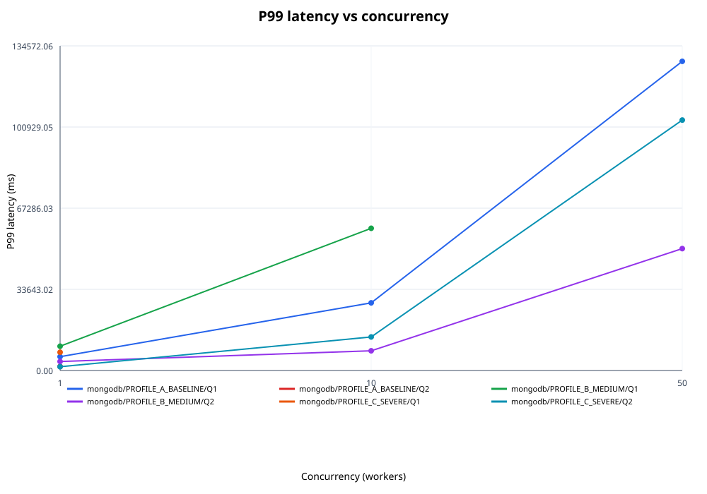
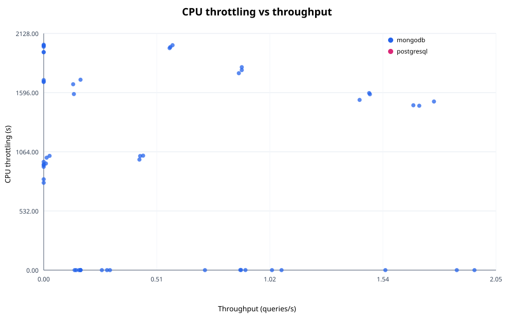
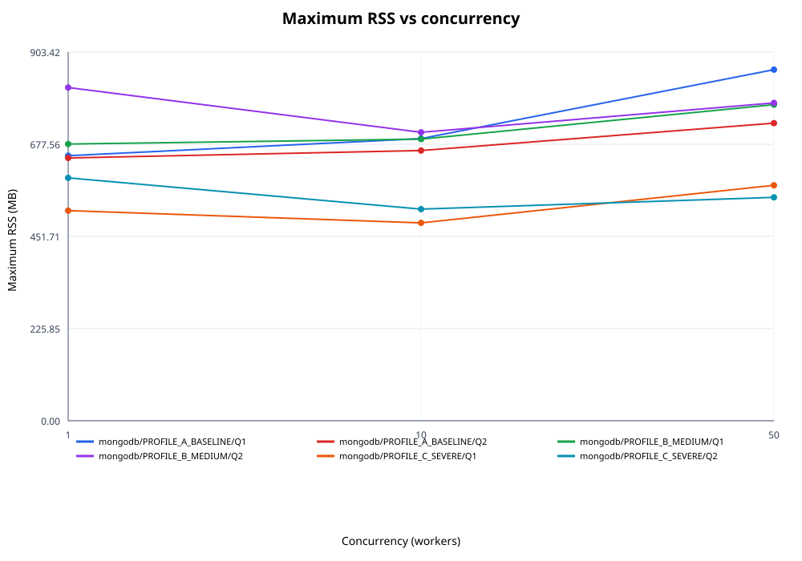

# Informe de métricas: MongoDB frente a PostgreSQL JSONB
Fuente de datos: `matrix-final-20261101-autoflush.csv`. Filas validadas: **108 de 108**.

## 1. Especificaciones del host y del entorno Docker
La matriz CSV no contiene inventario del hardware físico ni una captura de versiones efectivas del host/Docker. Esos datos se marcan como **no capturados**; no se sustituyen por valores de configuración planeados.

| Dato | Evidencia |
|---|---|
| CPU, memoria y modelo del host | No capturado en el CSV ni en el registro de ejecución suministrado |
| Versiones efectivas de WSL2 y Docker Engine | No capturadas durante la corrida |
| Perfiles comparados | PROFILE_A_BASELINE, PROFILE_B_MEDIUM, PROFILE_C_SEVERE (configuración declarada en el repositorio) |
| Dataset esperado | 500000 órdenes por motor/perfil; readiness se reporta en la sección 2 |

## 2. Método de medición y verificación del baseline
Se validó el esquema CSV y la cobertura de 108 claves únicas (2 motores × 3 perfiles × 2 consultas × 3 concurrencias × 3 repeticiones). Cada ejecución usa warmup de 60 s, medición de 300 s y cooldown de 60 s, según el playbook del proyecto.
- Vaciados de caché registrados como exitosos en el log: **109** (esperados: 108).
- Chequeos readiness registrados por perfil: PROFILE_A_BASELINE: 2, PROFILE_B_MEDIUM: 1, PROFILE_C_SEVERE: 1.
- El baseline solo se considera comprobado para perfiles con readiness registrado; no se infiere a partir de métricas vacías.

## 3. Resultados consolidados
Estados por corrida: ok: 36, spill: 0, oom: 0, error: 72. Evidencia de spill: true: 0, false: 39, unknown: 69.
Los valores de cada corrida se conservan. Media, mediana y rango min-max usan únicamente valores numéricos observados; `not observed` no equivale a cero.

| Engine | Profile | Query | Concurrency | Metric | Unit | Runs 1 / 2 / 3 | n | Mean | Median | Min-max |
|---|---|---|---:|---|---|---|---:|---:|---:|---|
| mongodb | PROFILE_A_BASELINE | Q1 | 1 | throughput_qps | queries/s | 0.263 / 0.287 / 0.300 | 3 | 0.283 | 0.287 | 0.263-0.300 |
| mongodb | PROFILE_A_BASELINE | Q1 | 1 | latency_p50_ms | ms | 3619.336 / 3260.260 / 3174.468 | 3 | 3351.355 | 3260.260 | 3174.468-3619.336 |
| mongodb | PROFILE_A_BASELINE | Q1 | 1 | latency_p95_ms | ms | 5686.929 / 4220.786 / 3848.079 | 3 | 4585.265 | 4220.786 | 3848.079-5686.929 |
| mongodb | PROFILE_A_BASELINE | Q1 | 1 | latency_p99_ms | ms | 7030.232 / 5555.297 / 4610.715 | 3 | 5732.081 | 5555.297 | 4610.715-7030.232 |
| mongodb | PROFILE_A_BASELINE | Q1 | 1 | cpu_throttled_seconds | s | 0.000 / 0.000 / 0.000 | 3 | 0.000 | 0.000 | 0.000-0.000 |
| mongodb | PROFILE_A_BASELINE | Q1 | 1 | max_rss_mb | MB | 647.234 / 649.848 / 651.508 | 3 | 649.530 | 649.848 | 647.234-651.508 |
| mongodb | PROFILE_A_BASELINE | Q1 | 10 | throughput_qps | queries/s | 0.450 / 0.437 / 0.433 | 3 | 0.440 | 0.437 | 0.433-0.450 |
| mongodb | PROFILE_A_BASELINE | Q1 | 10 | latency_p50_ms | ms | 19723.766 / 20944.729 / 21662.796 | 3 | 20777.097 | 20944.729 | 19723.766-21662.796 |
| mongodb | PROFILE_A_BASELINE | Q1 | 10 | latency_p95_ms | ms | 24314.625 / 26601.160 / 27411.737 | 3 | 26109.174 | 26601.160 | 24314.625-27411.737 |
| mongodb | PROFILE_A_BASELINE | Q1 | 10 | latency_p99_ms | ms | 25386.894 / 28466.395 / 30268.444 | 3 | 28040.578 | 28466.395 | 25386.894-30268.444 |
| mongodb | PROFILE_A_BASELINE | Q1 | 10 | cpu_throttled_seconds | s | 1029.148 / 1026.040 / 993.852 | 3 | 1016.346 | 1026.040 | 993.852-1029.148 |
| mongodb | PROFILE_A_BASELINE | Q1 | 10 | max_rss_mb | MB | 692.664 / 690.652 / 690.910 | 3 | 691.409 | 690.910 | 690.652-692.664 |
| mongodb | PROFILE_A_BASELINE | Q1 | 50 | throughput_qps | queries/s | 0.013 / 0.027 / 0.010 | 3 | 0.017 | 0.013 | 0.010-0.027 |
| mongodb | PROFILE_A_BASELINE | Q1 | 50 | latency_p50_ms | ms | 133363.582 / 102664.485 / 109101.537 | 3 | 115043.201 | 109101.537 | 102664.485-133363.582 |
| mongodb | PROFILE_A_BASELINE | Q1 | 50 | latency_p95_ms | ms | 144931.407 / 107609.604 / 128705.978 | 3 | 127082.330 | 128705.978 | 107609.604-144931.407 |
| mongodb | PROFILE_A_BASELINE | Q1 | 50 | latency_p99_ms | ms | 146338.856 / 107704.154 / 130448.595 | 3 | 128163.868 | 130448.595 | 107704.154-146338.856 |
| mongodb | PROFILE_A_BASELINE | Q1 | 50 | cpu_throttled_seconds | s | 1010.922 / 1027.371 / 958.506 | 3 | 998.933 | 1010.922 | 958.506-1027.371 |
| mongodb | PROFILE_A_BASELINE | Q1 | 50 | max_rss_mb | MB | 854.793 / 859.992 / 866.410 | 3 | 860.398 | 859.992 | 854.793-866.410 |
| mongodb | PROFILE_A_BASELINE | Q2 | 1 | throughput_qps | queries/s | 1.077 / 1.870 / 1.950 | 3 | 1.632 | 1.870 | 1.077-1.950 |
| mongodb | PROFILE_A_BASELINE | Q2 | 1 | latency_p50_ms | ms | 762.047 / 443.394 / 469.420 | 3 | 558.287 | 469.420 | 443.394-762.047 |
| mongodb | PROFILE_A_BASELINE | Q2 | 1 | latency_p95_ms | ms | 1856.153 / 1016.713 / 795.094 | 3 | 1222.653 | 1016.713 | 795.094-1856.153 |
| mongodb | PROFILE_A_BASELINE | Q2 | 1 | latency_p99_ms | ms | 2337.548 / 1655.661 / 1035.641 | 3 | 1676.283 | 1655.661 | 1035.641-2337.548 |
| mongodb | PROFILE_A_BASELINE | Q2 | 1 | cpu_throttled_seconds | s | 0.000 / 0.000 / 0.000 | 3 | 0.000 | 0.000 | 0.000-0.000 |
| mongodb | PROFILE_A_BASELINE | Q2 | 1 | max_rss_mb | MB | 640.062 / 645.168 / 646.914 | 3 | 644.048 | 645.168 | 640.062-646.914 |
| mongodb | PROFILE_A_BASELINE | Q2 | 10 | throughput_qps | queries/s | 0.000 / 0.000 / 0.000 | 3 | 0.000 | 0.000 | 0.000-0.000 |
| mongodb | PROFILE_A_BASELINE | Q2 | 10 | latency_p50_ms | ms | not observed / not observed / not observed | 0 | not observed | not observed | not observed |
| mongodb | PROFILE_A_BASELINE | Q2 | 10 | latency_p95_ms | ms | not observed / not observed / not observed | 0 | not observed | not observed | not observed |
| mongodb | PROFILE_A_BASELINE | Q2 | 10 | latency_p99_ms | ms | not observed / not observed / not observed | 0 | not observed | not observed | not observed |
| mongodb | PROFILE_A_BASELINE | Q2 | 10 | cpu_throttled_seconds | s | 944.402 / 973.642 / 950.775 | 3 | 956.273 | 950.775 | 944.402-973.642 |
| mongodb | PROFILE_A_BASELINE | Q2 | 10 | max_rss_mb | MB | 660.574 / 662.961 / 663.086 | 3 | 662.207 | 662.961 | 660.574-663.086 |
| mongodb | PROFILE_A_BASELINE | Q2 | 50 | throughput_qps | queries/s | 0.000 / 0.000 / 0.000 | 3 | 0.000 | 0.000 | 0.000-0.000 |
| mongodb | PROFILE_A_BASELINE | Q2 | 50 | latency_p50_ms | ms | not observed / not observed / not observed | 0 | not observed | not observed | not observed |
| mongodb | PROFILE_A_BASELINE | Q2 | 50 | latency_p95_ms | ms | not observed / not observed / not observed | 0 | not observed | not observed | not observed |
| mongodb | PROFILE_A_BASELINE | Q2 | 50 | latency_p99_ms | ms | not observed / not observed / not observed | 0 | not observed | not observed | not observed |
| mongodb | PROFILE_A_BASELINE | Q2 | 50 | cpu_throttled_seconds | s | 816.904 / 785.304 / 928.758 | 3 | 843.656 | 816.904 | 785.304-928.758 |
| mongodb | PROFILE_A_BASELINE | Q2 | 50 | max_rss_mb | MB | 727.957 / 729.711 / 730.277 | 3 | 729.315 | 729.711 | 727.957-730.277 |
| mongodb | PROFILE_B_MEDIUM | Q1 | 1 | throughput_qps | queries/s | 0.140 / 0.147 / 0.160 | 3 | 0.149 | 0.147 | 0.140-0.160 |
| mongodb | PROFILE_B_MEDIUM | Q1 | 1 | latency_p50_ms | ms | 6538.254 / 6320.232 / 5954.113 | 3 | 6270.866 | 6320.232 | 5954.113-6538.254 |
| mongodb | PROFILE_B_MEDIUM | Q1 | 1 | latency_p95_ms | ms | 9537.010 / 8792.313 / 7490.650 | 3 | 8606.658 | 8792.313 | 7490.650-9537.010 |
| mongodb | PROFILE_B_MEDIUM | Q1 | 1 | latency_p99_ms | ms | 10352.084 / 10510.248 / 9339.128 | 3 | 10067.153 | 10352.084 | 9339.128-10510.248 |
| mongodb | PROFILE_B_MEDIUM | Q1 | 1 | cpu_throttled_seconds | s | 0.000 / 0.000 / 0.000 | 3 | 0.000 | 0.000 | 0.000-0.000 |
| mongodb | PROFILE_B_MEDIUM | Q1 | 1 | max_rss_mb | MB | 644.711 / 681.324 / 708.387 | 3 | 678.141 | 681.324 | 644.711-708.387 |
| mongodb | PROFILE_B_MEDIUM | Q1 | 10 | throughput_qps | queries/s | 0.137 / 0.133 / 0.167 | 3 | 0.146 | 0.137 | 0.133-0.167 |
| mongodb | PROFILE_B_MEDIUM | Q1 | 10 | latency_p50_ms | ms | 52279.310 / 54717.777 / 46995.711 | 3 | 51330.933 | 52279.310 | 46995.711-54717.777 |
| mongodb | PROFILE_B_MEDIUM | Q1 | 10 | latency_p95_ms | ms | 57218.337 / 61046.407 / 51630.848 | 3 | 56631.864 | 57218.337 | 51630.848-61046.407 |
| mongodb | PROFILE_B_MEDIUM | Q1 | 10 | latency_p99_ms | ms | 59485.487 / 64084.471 / 53279.449 | 3 | 58949.802 | 59485.487 | 53279.449-64084.471 |
| mongodb | PROFILE_B_MEDIUM | Q1 | 10 | cpu_throttled_seconds | s | 1583.061 / 1671.234 / 1711.959 | 3 | 1655.418 | 1671.234 | 1583.061-1711.959 |
| mongodb | PROFILE_B_MEDIUM | Q1 | 10 | max_rss_mb | MB | 708.578 / 692.895 / 669.000 | 3 | 690.158 | 692.895 | 669.000-708.578 |
| mongodb | PROFILE_B_MEDIUM | Q1 | 50 | throughput_qps | queries/s | 0.000 / 0.000 / 0.000 | 3 | 0.000 | 0.000 | 0.000-0.000 |
| mongodb | PROFILE_B_MEDIUM | Q1 | 50 | latency_p50_ms | ms | not observed / not observed / not observed | 0 | not observed | not observed | not observed |
| mongodb | PROFILE_B_MEDIUM | Q1 | 50 | latency_p95_ms | ms | not observed / not observed / not observed | 0 | not observed | not observed | not observed |
| mongodb | PROFILE_B_MEDIUM | Q1 | 50 | latency_p99_ms | ms | not observed / not observed / not observed | 0 | not observed | not observed | not observed |
| mongodb | PROFILE_B_MEDIUM | Q1 | 50 | cpu_throttled_seconds | s | 1691.171 / 1696.135 / 1708.896 | 3 | 1698.734 | 1696.135 | 1691.171-1708.896 |
| mongodb | PROFILE_B_MEDIUM | Q1 | 50 | max_rss_mb | MB | 771.871 / 777.770 / 774.145 | 3 | 774.595 | 774.145 | 771.871-777.770 |
| mongodb | PROFILE_B_MEDIUM | Q2 | 1 | throughput_qps | queries/s | 1.547 / 0.730 / 1.033 | 3 | 1.103 | 1.033 | 0.730-1.547 |
| mongodb | PROFILE_B_MEDIUM | Q2 | 1 | latency_p50_ms | ms | 572.383 / 855.608 / 937.731 | 3 | 788.574 | 855.608 | 572.383-937.731 |
| mongodb | PROFILE_B_MEDIUM | Q2 | 1 | latency_p95_ms | ms | 1095.209 / 2802.913 / 1165.456 | 3 | 1687.859 | 1165.456 | 1095.209-2802.913 |
| mongodb | PROFILE_B_MEDIUM | Q2 | 1 | latency_p99_ms | ms | 1485.987 / 8362.406 / 1350.472 | 3 | 3732.955 | 1485.987 | 1350.472-8362.406 |
| mongodb | PROFILE_B_MEDIUM | Q2 | 1 | cpu_throttled_seconds | s | 0.199 / 0.000 / 0.000 | 3 | 0.066 | 0.000 | 0.000-0.199 |
| mongodb | PROFILE_B_MEDIUM | Q2 | 1 | max_rss_mb | MB | 807.469 / 756.559 / 885.582 | 3 | 816.537 | 807.469 | 756.559-885.582 |
| mongodb | PROFILE_B_MEDIUM | Q2 | 10 | throughput_qps | queries/s | 1.700 / 1.767 / 1.673 | 3 | 1.713 | 1.700 | 1.673-1.767 |
| mongodb | PROFILE_B_MEDIUM | Q2 | 10 | latency_p50_ms | ms | 5622.945 / 5594.382 / 5606.427 | 3 | 5607.918 | 5606.427 | 5594.382-5622.945 |
| mongodb | PROFILE_B_MEDIUM | Q2 | 10 | latency_p95_ms | ms | 6988.653 / 6317.638 / 7621.019 | 3 | 6975.770 | 6988.653 | 6317.638-7621.019 |
| mongodb | PROFILE_B_MEDIUM | Q2 | 10 | latency_p99_ms | ms | 7885.856 / 6806.214 / 9810.440 | 3 | 8167.503 | 7885.856 | 6806.214-9810.440 |
| mongodb | PROFILE_B_MEDIUM | Q2 | 10 | cpu_throttled_seconds | s | 1477.960 / 1515.938 / 1482.180 | 3 | 1492.026 | 1482.180 | 1477.960-1515.938 |
| mongodb | PROFILE_B_MEDIUM | Q2 | 10 | max_rss_mb | MB | 722.043 / 698.891 / 699.594 | 3 | 706.843 | 699.594 | 698.891-722.043 |
| mongodb | PROFILE_B_MEDIUM | Q2 | 50 | throughput_qps | queries/s | 1.430 / 1.473 / 1.477 | 3 | 1.460 | 1.473 | 1.430-1.477 |
| mongodb | PROFILE_B_MEDIUM | Q2 | 50 | latency_p50_ms | ms | 27693.280 / 30105.440 / 29603.344 | 3 | 29134.021 | 29603.344 | 27693.280-30105.440 |
| mongodb | PROFILE_B_MEDIUM | Q2 | 50 | latency_p95_ms | ms | 50458.672 / 40196.497 / 41404.623 | 3 | 44019.931 | 41404.623 | 40196.497-50458.672 |
| mongodb | PROFILE_B_MEDIUM | Q2 | 50 | latency_p99_ms | ms | 63043.388 / 44289.723 / 44252.747 | 3 | 50528.619 | 44289.723 | 44252.747-63043.388 |
| mongodb | PROFILE_B_MEDIUM | Q2 | 50 | cpu_throttled_seconds | s | 1530.418 / 1591.809 / 1581.261 | 3 | 1567.829 | 1581.261 | 1530.418-1591.809 |
| mongodb | PROFILE_B_MEDIUM | Q2 | 50 | max_rss_mb | MB | 783.586 / 774.812 / 778.254 | 3 | 778.884 | 778.254 | 774.812-783.586 |
| mongodb | PROFILE_C_SEVERE | Q1 | 1 | throughput_qps | queries/s | 0.167 / 0.167 / 0.167 | 3 | 0.167 | 0.167 | 0.167-0.167 |
| mongodb | PROFILE_C_SEVERE | Q1 | 1 | latency_p50_ms | ms | 5807.718 / 5782.639 / 5804.127 | 3 | 5798.161 | 5804.127 | 5782.639-5807.718 |
| mongodb | PROFILE_C_SEVERE | Q1 | 1 | latency_p95_ms | ms | 6927.952 / 6727.319 / 6216.389 | 3 | 6623.887 | 6727.319 | 6216.389-6927.952 |
| mongodb | PROFILE_C_SEVERE | Q1 | 1 | latency_p99_ms | ms | 7971.319 / 8126.834 / 6591.087 | 3 | 7563.080 | 7971.319 | 6591.087-8126.834 |
| mongodb | PROFILE_C_SEVERE | Q1 | 1 | cpu_throttled_seconds | s | 0.687 / 0.333 / 0.597 | 3 | 0.539 | 0.597 | 0.333-0.687 |
| mongodb | PROFILE_C_SEVERE | Q1 | 1 | max_rss_mb | MB | 464.332 / 535.426 / 545.008 | 3 | 514.922 | 535.426 | 464.332-545.008 |
| mongodb | PROFILE_C_SEVERE | Q1 | 10 | throughput_qps | queries/s | 0.000 / 0.000 / 0.000 | 3 | 0.000 | 0.000 | 0.000-0.000 |
| mongodb | PROFILE_C_SEVERE | Q1 | 10 | latency_p50_ms | ms | not observed / not observed / not observed | 0 | not observed | not observed | not observed |
| mongodb | PROFILE_C_SEVERE | Q1 | 10 | latency_p95_ms | ms | not observed / not observed / not observed | 0 | not observed | not observed | not observed |
| mongodb | PROFILE_C_SEVERE | Q1 | 10 | latency_p99_ms | ms | not observed / not observed / not observed | 0 | not observed | not observed | not observed |
| mongodb | PROFILE_C_SEVERE | Q1 | 10 | cpu_throttled_seconds | s | 1960.229 / 1959.027 / 2019.657 | 3 | 1979.638 | 1960.229 | 1959.027-2019.657 |
| mongodb | PROFILE_C_SEVERE | Q1 | 10 | max_rss_mb | MB | 547.473 / 470.512 / 436.629 | 3 | 484.871 | 470.512 | 436.629-547.473 |
| mongodb | PROFILE_C_SEVERE | Q1 | 50 | throughput_qps | queries/s | 0.000 / 0.000 / 0.000 | 3 | 0.000 | 0.000 | 0.000-0.000 |
| mongodb | PROFILE_C_SEVERE | Q1 | 50 | latency_p50_ms | ms | not observed / not observed / not observed | 0 | not observed | not observed | not observed |
| mongodb | PROFILE_C_SEVERE | Q1 | 50 | latency_p95_ms | ms | not observed / not observed / not observed | 0 | not observed | not observed | not observed |
| mongodb | PROFILE_C_SEVERE | Q1 | 50 | latency_p99_ms | ms | not observed / not observed / not observed | 0 | not observed | not observed | not observed |
| mongodb | PROFILE_C_SEVERE | Q1 | 50 | cpu_throttled_seconds | s | 2017.354 / 2008.441 / 2026.670 | 3 | 2017.488 | 2017.354 | 2008.441-2026.670 |
| mongodb | PROFILE_C_SEVERE | Q1 | 50 | max_rss_mb | MB | 558.430 / 586.340 / 586.375 | 3 | 577.048 | 586.340 | 558.430-586.375 |
| mongodb | PROFILE_C_SEVERE | Q2 | 1 | throughput_qps | queries/s | 0.893 / 0.913 / 0.890 | 3 | 0.899 | 0.893 | 0.890-0.913 |
| mongodb | PROFILE_C_SEVERE | Q2 | 1 | latency_p50_ms | ms | 1075.973 / 1074.890 / 1095.176 | 3 | 1082.013 | 1075.973 | 1074.890-1095.176 |
| mongodb | PROFILE_C_SEVERE | Q2 | 1 | latency_p95_ms | ms | 1364.277 / 1251.138 / 1298.936 | 3 | 1304.784 | 1298.936 | 1251.138-1364.277 |
| mongodb | PROFILE_C_SEVERE | Q2 | 1 | latency_p99_ms | ms | 1648.194 / 1359.437 / 1693.443 | 3 | 1567.025 | 1648.194 | 1359.437-1693.443 |
| mongodb | PROFILE_C_SEVERE | Q2 | 1 | cpu_throttled_seconds | s | 1.094 / 0.638 / 1.269 | 3 | 1.000 | 1.094 | 0.638-1.269 |
| mongodb | PROFILE_C_SEVERE | Q2 | 1 | max_rss_mb | MB | 612.023 / 590.215 / 583.316 | 3 | 595.185 | 590.215 | 583.316-612.023 |
| mongodb | PROFILE_C_SEVERE | Q2 | 10 | throughput_qps | queries/s | 0.897 / 0.883 / 0.897 | 3 | 0.892 | 0.897 | 0.883-0.897 |
| mongodb | PROFILE_C_SEVERE | Q2 | 10 | latency_p50_ms | ms | 10518.289 / 10600.194 / 10591.435 | 3 | 10569.973 | 10591.435 | 10518.289-10600.194 |
| mongodb | PROFILE_C_SEVERE | Q2 | 10 | latency_p95_ms | ms | 11004.583 / 11611.658 / 11646.617 | 3 | 11420.953 | 11611.658 | 11004.583-11646.617 |
| mongodb | PROFILE_C_SEVERE | Q2 | 10 | latency_p99_ms | ms | 11635.246 / 16951.326 / 13143.285 | 3 | 13909.952 | 13143.285 | 11635.246-16951.326 |
| mongodb | PROFILE_C_SEVERE | Q2 | 10 | cpu_throttled_seconds | s | 1824.817 / 1770.485 / 1798.506 | 3 | 1797.936 | 1798.506 | 1770.485-1824.817 |
| mongodb | PROFILE_C_SEVERE | Q2 | 10 | max_rss_mb | MB | 549.043 / 517.355 / 489.484 | 3 | 518.627 | 517.355 | 489.484-549.043 |
| mongodb | PROFILE_C_SEVERE | Q2 | 50 | throughput_qps | queries/s | 0.570 / 0.573 / 0.583 | 3 | 0.576 | 0.573 | 0.570-0.583 |
| mongodb | PROFILE_C_SEVERE | Q2 | 50 | latency_p50_ms | ms | 60508.448 / 64141.984 / 61105.950 | 3 | 61918.794 | 61105.950 | 60508.448-64141.984 |
| mongodb | PROFILE_C_SEVERE | Q2 | 50 | latency_p95_ms | ms | 107948.792 / 89319.045 / 76665.611 | 3 | 91311.149 | 89319.045 | 76665.611-107948.792 |
| mongodb | PROFILE_C_SEVERE | Q2 | 50 | latency_p99_ms | ms | 126369.043 / 98751.442 / 86319.003 | 3 | 103813.163 | 98751.442 | 86319.003-126369.043 |
| mongodb | PROFILE_C_SEVERE | Q2 | 50 | cpu_throttled_seconds | s | 1996.098 / 2005.785 / 2022.432 | 3 | 2008.105 | 2005.785 | 1996.098-2022.432 |
| mongodb | PROFILE_C_SEVERE | Q2 | 50 | max_rss_mb | MB | 550.086 / 549.793 / 542.539 | 3 | 547.473 | 549.793 | 542.539-550.086 |
| postgresql | PROFILE_A_BASELINE | Q1 | 1 | throughput_qps | queries/s | not observed / not observed / not observed | 0 | not observed | not observed | not observed |
| postgresql | PROFILE_A_BASELINE | Q1 | 1 | latency_p50_ms | ms | not observed / not observed / not observed | 0 | not observed | not observed | not observed |
| postgresql | PROFILE_A_BASELINE | Q1 | 1 | latency_p95_ms | ms | not observed / not observed / not observed | 0 | not observed | not observed | not observed |
| postgresql | PROFILE_A_BASELINE | Q1 | 1 | latency_p99_ms | ms | not observed / not observed / not observed | 0 | not observed | not observed | not observed |
| postgresql | PROFILE_A_BASELINE | Q1 | 1 | cpu_throttled_seconds | s | not observed / not observed / not observed | 0 | not observed | not observed | not observed |
| postgresql | PROFILE_A_BASELINE | Q1 | 1 | max_rss_mb | MB | not observed / not observed / not observed | 0 | not observed | not observed | not observed |
| postgresql | PROFILE_A_BASELINE | Q1 | 10 | throughput_qps | queries/s | not observed / not observed / not observed | 0 | not observed | not observed | not observed |
| postgresql | PROFILE_A_BASELINE | Q1 | 10 | latency_p50_ms | ms | not observed / not observed / not observed | 0 | not observed | not observed | not observed |
| postgresql | PROFILE_A_BASELINE | Q1 | 10 | latency_p95_ms | ms | not observed / not observed / not observed | 0 | not observed | not observed | not observed |
| postgresql | PROFILE_A_BASELINE | Q1 | 10 | latency_p99_ms | ms | not observed / not observed / not observed | 0 | not observed | not observed | not observed |
| postgresql | PROFILE_A_BASELINE | Q1 | 10 | cpu_throttled_seconds | s | not observed / not observed / not observed | 0 | not observed | not observed | not observed |
| postgresql | PROFILE_A_BASELINE | Q1 | 10 | max_rss_mb | MB | not observed / not observed / not observed | 0 | not observed | not observed | not observed |
| postgresql | PROFILE_A_BASELINE | Q1 | 50 | throughput_qps | queries/s | not observed / not observed / not observed | 0 | not observed | not observed | not observed |
| postgresql | PROFILE_A_BASELINE | Q1 | 50 | latency_p50_ms | ms | not observed / not observed / not observed | 0 | not observed | not observed | not observed |
| postgresql | PROFILE_A_BASELINE | Q1 | 50 | latency_p95_ms | ms | not observed / not observed / not observed | 0 | not observed | not observed | not observed |
| postgresql | PROFILE_A_BASELINE | Q1 | 50 | latency_p99_ms | ms | not observed / not observed / not observed | 0 | not observed | not observed | not observed |
| postgresql | PROFILE_A_BASELINE | Q1 | 50 | cpu_throttled_seconds | s | not observed / not observed / not observed | 0 | not observed | not observed | not observed |
| postgresql | PROFILE_A_BASELINE | Q1 | 50 | max_rss_mb | MB | not observed / not observed / not observed | 0 | not observed | not observed | not observed |
| postgresql | PROFILE_A_BASELINE | Q2 | 1 | throughput_qps | queries/s | not observed / not observed / not observed | 0 | not observed | not observed | not observed |
| postgresql | PROFILE_A_BASELINE | Q2 | 1 | latency_p50_ms | ms | not observed / not observed / not observed | 0 | not observed | not observed | not observed |
| postgresql | PROFILE_A_BASELINE | Q2 | 1 | latency_p95_ms | ms | not observed / not observed / not observed | 0 | not observed | not observed | not observed |
| postgresql | PROFILE_A_BASELINE | Q2 | 1 | latency_p99_ms | ms | not observed / not observed / not observed | 0 | not observed | not observed | not observed |
| postgresql | PROFILE_A_BASELINE | Q2 | 1 | cpu_throttled_seconds | s | not observed / not observed / not observed | 0 | not observed | not observed | not observed |
| postgresql | PROFILE_A_BASELINE | Q2 | 1 | max_rss_mb | MB | not observed / not observed / not observed | 0 | not observed | not observed | not observed |
| postgresql | PROFILE_A_BASELINE | Q2 | 10 | throughput_qps | queries/s | not observed / not observed / not observed | 0 | not observed | not observed | not observed |
| postgresql | PROFILE_A_BASELINE | Q2 | 10 | latency_p50_ms | ms | not observed / not observed / not observed | 0 | not observed | not observed | not observed |
| postgresql | PROFILE_A_BASELINE | Q2 | 10 | latency_p95_ms | ms | not observed / not observed / not observed | 0 | not observed | not observed | not observed |
| postgresql | PROFILE_A_BASELINE | Q2 | 10 | latency_p99_ms | ms | not observed / not observed / not observed | 0 | not observed | not observed | not observed |
| postgresql | PROFILE_A_BASELINE | Q2 | 10 | cpu_throttled_seconds | s | not observed / not observed / not observed | 0 | not observed | not observed | not observed |
| postgresql | PROFILE_A_BASELINE | Q2 | 10 | max_rss_mb | MB | not observed / not observed / not observed | 0 | not observed | not observed | not observed |
| postgresql | PROFILE_A_BASELINE | Q2 | 50 | throughput_qps | queries/s | not observed / not observed / not observed | 0 | not observed | not observed | not observed |
| postgresql | PROFILE_A_BASELINE | Q2 | 50 | latency_p50_ms | ms | not observed / not observed / not observed | 0 | not observed | not observed | not observed |
| postgresql | PROFILE_A_BASELINE | Q2 | 50 | latency_p95_ms | ms | not observed / not observed / not observed | 0 | not observed | not observed | not observed |
| postgresql | PROFILE_A_BASELINE | Q2 | 50 | latency_p99_ms | ms | not observed / not observed / not observed | 0 | not observed | not observed | not observed |
| postgresql | PROFILE_A_BASELINE | Q2 | 50 | cpu_throttled_seconds | s | not observed / not observed / not observed | 0 | not observed | not observed | not observed |
| postgresql | PROFILE_A_BASELINE | Q2 | 50 | max_rss_mb | MB | not observed / not observed / not observed | 0 | not observed | not observed | not observed |
| postgresql | PROFILE_B_MEDIUM | Q1 | 1 | throughput_qps | queries/s | not observed / not observed / not observed | 0 | not observed | not observed | not observed |
| postgresql | PROFILE_B_MEDIUM | Q1 | 1 | latency_p50_ms | ms | not observed / not observed / not observed | 0 | not observed | not observed | not observed |
| postgresql | PROFILE_B_MEDIUM | Q1 | 1 | latency_p95_ms | ms | not observed / not observed / not observed | 0 | not observed | not observed | not observed |
| postgresql | PROFILE_B_MEDIUM | Q1 | 1 | latency_p99_ms | ms | not observed / not observed / not observed | 0 | not observed | not observed | not observed |
| postgresql | PROFILE_B_MEDIUM | Q1 | 1 | cpu_throttled_seconds | s | not observed / not observed / not observed | 0 | not observed | not observed | not observed |
| postgresql | PROFILE_B_MEDIUM | Q1 | 1 | max_rss_mb | MB | not observed / not observed / not observed | 0 | not observed | not observed | not observed |
| postgresql | PROFILE_B_MEDIUM | Q1 | 10 | throughput_qps | queries/s | not observed / not observed / not observed | 0 | not observed | not observed | not observed |
| postgresql | PROFILE_B_MEDIUM | Q1 | 10 | latency_p50_ms | ms | not observed / not observed / not observed | 0 | not observed | not observed | not observed |
| postgresql | PROFILE_B_MEDIUM | Q1 | 10 | latency_p95_ms | ms | not observed / not observed / not observed | 0 | not observed | not observed | not observed |
| postgresql | PROFILE_B_MEDIUM | Q1 | 10 | latency_p99_ms | ms | not observed / not observed / not observed | 0 | not observed | not observed | not observed |
| postgresql | PROFILE_B_MEDIUM | Q1 | 10 | cpu_throttled_seconds | s | not observed / not observed / not observed | 0 | not observed | not observed | not observed |
| postgresql | PROFILE_B_MEDIUM | Q1 | 10 | max_rss_mb | MB | not observed / not observed / not observed | 0 | not observed | not observed | not observed |
| postgresql | PROFILE_B_MEDIUM | Q1 | 50 | throughput_qps | queries/s | not observed / not observed / not observed | 0 | not observed | not observed | not observed |
| postgresql | PROFILE_B_MEDIUM | Q1 | 50 | latency_p50_ms | ms | not observed / not observed / not observed | 0 | not observed | not observed | not observed |
| postgresql | PROFILE_B_MEDIUM | Q1 | 50 | latency_p95_ms | ms | not observed / not observed / not observed | 0 | not observed | not observed | not observed |
| postgresql | PROFILE_B_MEDIUM | Q1 | 50 | latency_p99_ms | ms | not observed / not observed / not observed | 0 | not observed | not observed | not observed |
| postgresql | PROFILE_B_MEDIUM | Q1 | 50 | cpu_throttled_seconds | s | not observed / not observed / not observed | 0 | not observed | not observed | not observed |
| postgresql | PROFILE_B_MEDIUM | Q1 | 50 | max_rss_mb | MB | not observed / not observed / not observed | 0 | not observed | not observed | not observed |
| postgresql | PROFILE_B_MEDIUM | Q2 | 1 | throughput_qps | queries/s | not observed / not observed / not observed | 0 | not observed | not observed | not observed |
| postgresql | PROFILE_B_MEDIUM | Q2 | 1 | latency_p50_ms | ms | not observed / not observed / not observed | 0 | not observed | not observed | not observed |
| postgresql | PROFILE_B_MEDIUM | Q2 | 1 | latency_p95_ms | ms | not observed / not observed / not observed | 0 | not observed | not observed | not observed |
| postgresql | PROFILE_B_MEDIUM | Q2 | 1 | latency_p99_ms | ms | not observed / not observed / not observed | 0 | not observed | not observed | not observed |
| postgresql | PROFILE_B_MEDIUM | Q2 | 1 | cpu_throttled_seconds | s | not observed / not observed / not observed | 0 | not observed | not observed | not observed |
| postgresql | PROFILE_B_MEDIUM | Q2 | 1 | max_rss_mb | MB | not observed / not observed / not observed | 0 | not observed | not observed | not observed |
| postgresql | PROFILE_B_MEDIUM | Q2 | 10 | throughput_qps | queries/s | not observed / not observed / not observed | 0 | not observed | not observed | not observed |
| postgresql | PROFILE_B_MEDIUM | Q2 | 10 | latency_p50_ms | ms | not observed / not observed / not observed | 0 | not observed | not observed | not observed |
| postgresql | PROFILE_B_MEDIUM | Q2 | 10 | latency_p95_ms | ms | not observed / not observed / not observed | 0 | not observed | not observed | not observed |
| postgresql | PROFILE_B_MEDIUM | Q2 | 10 | latency_p99_ms | ms | not observed / not observed / not observed | 0 | not observed | not observed | not observed |
| postgresql | PROFILE_B_MEDIUM | Q2 | 10 | cpu_throttled_seconds | s | not observed / not observed / not observed | 0 | not observed | not observed | not observed |
| postgresql | PROFILE_B_MEDIUM | Q2 | 10 | max_rss_mb | MB | not observed / not observed / not observed | 0 | not observed | not observed | not observed |
| postgresql | PROFILE_B_MEDIUM | Q2 | 50 | throughput_qps | queries/s | not observed / not observed / not observed | 0 | not observed | not observed | not observed |
| postgresql | PROFILE_B_MEDIUM | Q2 | 50 | latency_p50_ms | ms | not observed / not observed / not observed | 0 | not observed | not observed | not observed |
| postgresql | PROFILE_B_MEDIUM | Q2 | 50 | latency_p95_ms | ms | not observed / not observed / not observed | 0 | not observed | not observed | not observed |
| postgresql | PROFILE_B_MEDIUM | Q2 | 50 | latency_p99_ms | ms | not observed / not observed / not observed | 0 | not observed | not observed | not observed |
| postgresql | PROFILE_B_MEDIUM | Q2 | 50 | cpu_throttled_seconds | s | not observed / not observed / not observed | 0 | not observed | not observed | not observed |
| postgresql | PROFILE_B_MEDIUM | Q2 | 50 | max_rss_mb | MB | not observed / not observed / not observed | 0 | not observed | not observed | not observed |
| postgresql | PROFILE_C_SEVERE | Q1 | 1 | throughput_qps | queries/s | not observed / not observed / not observed | 0 | not observed | not observed | not observed |
| postgresql | PROFILE_C_SEVERE | Q1 | 1 | latency_p50_ms | ms | not observed / not observed / not observed | 0 | not observed | not observed | not observed |
| postgresql | PROFILE_C_SEVERE | Q1 | 1 | latency_p95_ms | ms | not observed / not observed / not observed | 0 | not observed | not observed | not observed |
| postgresql | PROFILE_C_SEVERE | Q1 | 1 | latency_p99_ms | ms | not observed / not observed / not observed | 0 | not observed | not observed | not observed |
| postgresql | PROFILE_C_SEVERE | Q1 | 1 | cpu_throttled_seconds | s | not observed / not observed / not observed | 0 | not observed | not observed | not observed |
| postgresql | PROFILE_C_SEVERE | Q1 | 1 | max_rss_mb | MB | not observed / not observed / not observed | 0 | not observed | not observed | not observed |
| postgresql | PROFILE_C_SEVERE | Q1 | 10 | throughput_qps | queries/s | not observed / not observed / not observed | 0 | not observed | not observed | not observed |
| postgresql | PROFILE_C_SEVERE | Q1 | 10 | latency_p50_ms | ms | not observed / not observed / not observed | 0 | not observed | not observed | not observed |
| postgresql | PROFILE_C_SEVERE | Q1 | 10 | latency_p95_ms | ms | not observed / not observed / not observed | 0 | not observed | not observed | not observed |
| postgresql | PROFILE_C_SEVERE | Q1 | 10 | latency_p99_ms | ms | not observed / not observed / not observed | 0 | not observed | not observed | not observed |
| postgresql | PROFILE_C_SEVERE | Q1 | 10 | cpu_throttled_seconds | s | not observed / not observed / not observed | 0 | not observed | not observed | not observed |
| postgresql | PROFILE_C_SEVERE | Q1 | 10 | max_rss_mb | MB | not observed / not observed / not observed | 0 | not observed | not observed | not observed |
| postgresql | PROFILE_C_SEVERE | Q1 | 50 | throughput_qps | queries/s | not observed / not observed / not observed | 0 | not observed | not observed | not observed |
| postgresql | PROFILE_C_SEVERE | Q1 | 50 | latency_p50_ms | ms | not observed / not observed / not observed | 0 | not observed | not observed | not observed |
| postgresql | PROFILE_C_SEVERE | Q1 | 50 | latency_p95_ms | ms | not observed / not observed / not observed | 0 | not observed | not observed | not observed |
| postgresql | PROFILE_C_SEVERE | Q1 | 50 | latency_p99_ms | ms | not observed / not observed / not observed | 0 | not observed | not observed | not observed |
| postgresql | PROFILE_C_SEVERE | Q1 | 50 | cpu_throttled_seconds | s | not observed / not observed / not observed | 0 | not observed | not observed | not observed |
| postgresql | PROFILE_C_SEVERE | Q1 | 50 | max_rss_mb | MB | not observed / not observed / not observed | 0 | not observed | not observed | not observed |
| postgresql | PROFILE_C_SEVERE | Q2 | 1 | throughput_qps | queries/s | not observed / not observed / not observed | 0 | not observed | not observed | not observed |
| postgresql | PROFILE_C_SEVERE | Q2 | 1 | latency_p50_ms | ms | not observed / not observed / not observed | 0 | not observed | not observed | not observed |
| postgresql | PROFILE_C_SEVERE | Q2 | 1 | latency_p95_ms | ms | not observed / not observed / not observed | 0 | not observed | not observed | not observed |
| postgresql | PROFILE_C_SEVERE | Q2 | 1 | latency_p99_ms | ms | not observed / not observed / not observed | 0 | not observed | not observed | not observed |
| postgresql | PROFILE_C_SEVERE | Q2 | 1 | cpu_throttled_seconds | s | not observed / not observed / not observed | 0 | not observed | not observed | not observed |
| postgresql | PROFILE_C_SEVERE | Q2 | 1 | max_rss_mb | MB | not observed / not observed / not observed | 0 | not observed | not observed | not observed |
| postgresql | PROFILE_C_SEVERE | Q2 | 10 | throughput_qps | queries/s | not observed / not observed / not observed | 0 | not observed | not observed | not observed |
| postgresql | PROFILE_C_SEVERE | Q2 | 10 | latency_p50_ms | ms | not observed / not observed / not observed | 0 | not observed | not observed | not observed |
| postgresql | PROFILE_C_SEVERE | Q2 | 10 | latency_p95_ms | ms | not observed / not observed / not observed | 0 | not observed | not observed | not observed |
| postgresql | PROFILE_C_SEVERE | Q2 | 10 | latency_p99_ms | ms | not observed / not observed / not observed | 0 | not observed | not observed | not observed |
| postgresql | PROFILE_C_SEVERE | Q2 | 10 | cpu_throttled_seconds | s | not observed / not observed / not observed | 0 | not observed | not observed | not observed |
| postgresql | PROFILE_C_SEVERE | Q2 | 10 | max_rss_mb | MB | not observed / not observed / not observed | 0 | not observed | not observed | not observed |
| postgresql | PROFILE_C_SEVERE | Q2 | 50 | throughput_qps | queries/s | not observed / not observed / not observed | 0 | not observed | not observed | not observed |
| postgresql | PROFILE_C_SEVERE | Q2 | 50 | latency_p50_ms | ms | not observed / not observed / not observed | 0 | not observed | not observed | not observed |
| postgresql | PROFILE_C_SEVERE | Q2 | 50 | latency_p95_ms | ms | not observed / not observed / not observed | 0 | not observed | not observed | not observed |
| postgresql | PROFILE_C_SEVERE | Q2 | 50 | latency_p99_ms | ms | not observed / not observed / not observed | 0 | not observed | not observed | not observed |
| postgresql | PROFILE_C_SEVERE | Q2 | 50 | cpu_throttled_seconds | s | not observed / not observed / not observed | 0 | not observed | not observed | not observed |
| postgresql | PROFILE_C_SEVERE | Q2 | 50 | max_rss_mb | MB | not observed / not observed / not observed | 0 | not observed | not observed | not observed |

### Estado y spill por corrida
| Engine | Profile | Query | Concurrency | Run | Status | Spill observed |
|---|---|---|---:|---:|---|---|
| mongodb | PROFILE_A_BASELINE | Q1 | 1 | 1 | ok | false |
| mongodb | PROFILE_A_BASELINE | Q1 | 1 | 2 | ok | false |
| mongodb | PROFILE_A_BASELINE | Q1 | 1 | 3 | ok | false |
| mongodb | PROFILE_A_BASELINE | Q1 | 10 | 1 | ok | false |
| mongodb | PROFILE_A_BASELINE | Q1 | 10 | 2 | ok | false |
| mongodb | PROFILE_A_BASELINE | Q1 | 10 | 3 | ok | false |
| mongodb | PROFILE_A_BASELINE | Q1 | 50 | 1 | error | false |
| mongodb | PROFILE_A_BASELINE | Q1 | 50 | 2 | error | false |
| mongodb | PROFILE_A_BASELINE | Q1 | 50 | 3 | error | false |
| mongodb | PROFILE_A_BASELINE | Q2 | 1 | 1 | ok | false |
| mongodb | PROFILE_A_BASELINE | Q2 | 1 | 2 | ok | false |
| mongodb | PROFILE_A_BASELINE | Q2 | 1 | 3 | ok | false |
| mongodb | PROFILE_A_BASELINE | Q2 | 10 | 1 | error | unknown |
| mongodb | PROFILE_A_BASELINE | Q2 | 10 | 2 | error | unknown |
| mongodb | PROFILE_A_BASELINE | Q2 | 10 | 3 | error | unknown |
| mongodb | PROFILE_A_BASELINE | Q2 | 50 | 1 | error | unknown |
| mongodb | PROFILE_A_BASELINE | Q2 | 50 | 2 | error | unknown |
| mongodb | PROFILE_A_BASELINE | Q2 | 50 | 3 | error | unknown |
| mongodb | PROFILE_B_MEDIUM | Q1 | 1 | 1 | ok | false |
| mongodb | PROFILE_B_MEDIUM | Q1 | 1 | 2 | ok | false |
| mongodb | PROFILE_B_MEDIUM | Q1 | 1 | 3 | ok | false |
| mongodb | PROFILE_B_MEDIUM | Q1 | 10 | 1 | ok | false |
| mongodb | PROFILE_B_MEDIUM | Q1 | 10 | 2 | ok | false |
| mongodb | PROFILE_B_MEDIUM | Q1 | 10 | 3 | ok | false |
| mongodb | PROFILE_B_MEDIUM | Q1 | 50 | 1 | error | unknown |
| mongodb | PROFILE_B_MEDIUM | Q1 | 50 | 2 | error | unknown |
| mongodb | PROFILE_B_MEDIUM | Q1 | 50 | 3 | error | unknown |
| mongodb | PROFILE_B_MEDIUM | Q2 | 1 | 1 | ok | false |
| mongodb | PROFILE_B_MEDIUM | Q2 | 1 | 2 | ok | false |
| mongodb | PROFILE_B_MEDIUM | Q2 | 1 | 3 | ok | false |
| mongodb | PROFILE_B_MEDIUM | Q2 | 10 | 1 | ok | false |
| mongodb | PROFILE_B_MEDIUM | Q2 | 10 | 2 | ok | false |
| mongodb | PROFILE_B_MEDIUM | Q2 | 10 | 3 | ok | false |
| mongodb | PROFILE_B_MEDIUM | Q2 | 50 | 1 | ok | false |
| mongodb | PROFILE_B_MEDIUM | Q2 | 50 | 2 | ok | false |
| mongodb | PROFILE_B_MEDIUM | Q2 | 50 | 3 | ok | false |
| mongodb | PROFILE_C_SEVERE | Q1 | 1 | 1 | ok | false |
| mongodb | PROFILE_C_SEVERE | Q1 | 1 | 2 | ok | false |
| mongodb | PROFILE_C_SEVERE | Q1 | 1 | 3 | ok | false |
| mongodb | PROFILE_C_SEVERE | Q1 | 10 | 1 | error | unknown |
| mongodb | PROFILE_C_SEVERE | Q1 | 10 | 2 | error | unknown |
| mongodb | PROFILE_C_SEVERE | Q1 | 10 | 3 | error | unknown |
| mongodb | PROFILE_C_SEVERE | Q1 | 50 | 1 | error | unknown |
| mongodb | PROFILE_C_SEVERE | Q1 | 50 | 2 | error | unknown |
| mongodb | PROFILE_C_SEVERE | Q1 | 50 | 3 | error | unknown |
| mongodb | PROFILE_C_SEVERE | Q2 | 1 | 1 | ok | false |
| mongodb | PROFILE_C_SEVERE | Q2 | 1 | 2 | ok | false |
| mongodb | PROFILE_C_SEVERE | Q2 | 1 | 3 | ok | false |
| mongodb | PROFILE_C_SEVERE | Q2 | 10 | 1 | ok | false |
| mongodb | PROFILE_C_SEVERE | Q2 | 10 | 2 | ok | false |
| mongodb | PROFILE_C_SEVERE | Q2 | 10 | 3 | ok | false |
| mongodb | PROFILE_C_SEVERE | Q2 | 50 | 1 | ok | false |
| mongodb | PROFILE_C_SEVERE | Q2 | 50 | 2 | ok | false |
| mongodb | PROFILE_C_SEVERE | Q2 | 50 | 3 | ok | false |
| postgresql | PROFILE_A_BASELINE | Q1 | 1 | 1 | error | unknown |
| postgresql | PROFILE_A_BASELINE | Q1 | 1 | 2 | error | unknown |
| postgresql | PROFILE_A_BASELINE | Q1 | 1 | 3 | error | unknown |
| postgresql | PROFILE_A_BASELINE | Q1 | 10 | 1 | error | unknown |
| postgresql | PROFILE_A_BASELINE | Q1 | 10 | 2 | error | unknown |
| postgresql | PROFILE_A_BASELINE | Q1 | 10 | 3 | error | unknown |
| postgresql | PROFILE_A_BASELINE | Q1 | 50 | 1 | error | unknown |
| postgresql | PROFILE_A_BASELINE | Q1 | 50 | 2 | error | unknown |
| postgresql | PROFILE_A_BASELINE | Q1 | 50 | 3 | error | unknown |
| postgresql | PROFILE_A_BASELINE | Q2 | 1 | 1 | error | unknown |
| postgresql | PROFILE_A_BASELINE | Q2 | 1 | 2 | error | unknown |
| postgresql | PROFILE_A_BASELINE | Q2 | 1 | 3 | error | unknown |
| postgresql | PROFILE_A_BASELINE | Q2 | 10 | 1 | error | unknown |
| postgresql | PROFILE_A_BASELINE | Q2 | 10 | 2 | error | unknown |
| postgresql | PROFILE_A_BASELINE | Q2 | 10 | 3 | error | unknown |
| postgresql | PROFILE_A_BASELINE | Q2 | 50 | 1 | error | unknown |
| postgresql | PROFILE_A_BASELINE | Q2 | 50 | 2 | error | unknown |
| postgresql | PROFILE_A_BASELINE | Q2 | 50 | 3 | error | unknown |
| postgresql | PROFILE_B_MEDIUM | Q1 | 1 | 1 | error | unknown |
| postgresql | PROFILE_B_MEDIUM | Q1 | 1 | 2 | error | unknown |
| postgresql | PROFILE_B_MEDIUM | Q1 | 1 | 3 | error | unknown |
| postgresql | PROFILE_B_MEDIUM | Q1 | 10 | 1 | error | unknown |
| postgresql | PROFILE_B_MEDIUM | Q1 | 10 | 2 | error | unknown |
| postgresql | PROFILE_B_MEDIUM | Q1 | 10 | 3 | error | unknown |
| postgresql | PROFILE_B_MEDIUM | Q1 | 50 | 1 | error | unknown |
| postgresql | PROFILE_B_MEDIUM | Q1 | 50 | 2 | error | unknown |
| postgresql | PROFILE_B_MEDIUM | Q1 | 50 | 3 | error | unknown |
| postgresql | PROFILE_B_MEDIUM | Q2 | 1 | 1 | error | unknown |
| postgresql | PROFILE_B_MEDIUM | Q2 | 1 | 2 | error | unknown |
| postgresql | PROFILE_B_MEDIUM | Q2 | 1 | 3 | error | unknown |
| postgresql | PROFILE_B_MEDIUM | Q2 | 10 | 1 | error | unknown |
| postgresql | PROFILE_B_MEDIUM | Q2 | 10 | 2 | error | unknown |
| postgresql | PROFILE_B_MEDIUM | Q2 | 10 | 3 | error | unknown |
| postgresql | PROFILE_B_MEDIUM | Q2 | 50 | 1 | error | unknown |
| postgresql | PROFILE_B_MEDIUM | Q2 | 50 | 2 | error | unknown |
| postgresql | PROFILE_B_MEDIUM | Q2 | 50 | 3 | error | unknown |
| postgresql | PROFILE_C_SEVERE | Q1 | 1 | 1 | error | unknown |
| postgresql | PROFILE_C_SEVERE | Q1 | 1 | 2 | error | unknown |
| postgresql | PROFILE_C_SEVERE | Q1 | 1 | 3 | error | unknown |
| postgresql | PROFILE_C_SEVERE | Q1 | 10 | 1 | error | unknown |
| postgresql | PROFILE_C_SEVERE | Q1 | 10 | 2 | error | unknown |
| postgresql | PROFILE_C_SEVERE | Q1 | 10 | 3 | error | unknown |
| postgresql | PROFILE_C_SEVERE | Q1 | 50 | 1 | error | unknown |
| postgresql | PROFILE_C_SEVERE | Q1 | 50 | 2 | error | unknown |
| postgresql | PROFILE_C_SEVERE | Q1 | 50 | 3 | error | unknown |
| postgresql | PROFILE_C_SEVERE | Q2 | 1 | 1 | error | unknown |
| postgresql | PROFILE_C_SEVERE | Q2 | 1 | 2 | error | unknown |
| postgresql | PROFILE_C_SEVERE | Q2 | 1 | 3 | error | unknown |
| postgresql | PROFILE_C_SEVERE | Q2 | 10 | 1 | error | unknown |
| postgresql | PROFILE_C_SEVERE | Q2 | 10 | 2 | error | unknown |
| postgresql | PROFILE_C_SEVERE | Q2 | 10 | 3 | error | unknown |
| postgresql | PROFILE_C_SEVERE | Q2 | 50 | 1 | error | unknown |
| postgresql | PROFILE_C_SEVERE | Q2 | 50 | 2 | error | unknown |
| postgresql | PROFILE_C_SEVERE | Q2 | 50 | 3 | error | unknown |

### Diagnósticos registrados por el runner
- `mongodb PROFILE_A_BASELINE Q1 concurrency=50 run=1: worker_forced_shutdown,worker_result_missing`
- `mongodb PROFILE_A_BASELINE Q1 concurrency=50 run=2: worker_forced_shutdown,worker_result_missing`
- `mongodb PROFILE_A_BASELINE Q1 concurrency=50 run=3: worker_forced_shutdown,worker_result_missing`
- `mongodb PROFILE_A_BASELINE Q2 concurrency=10 run=1: spill_evidence_unknown,worker_forced_shutdown,worker_result_missing`
- `mongodb PROFILE_A_BASELINE Q2 concurrency=10 run=2: spill_evidence_unknown,worker_forced_shutdown,worker_result_missing`
- `mongodb PROFILE_A_BASELINE Q2 concurrency=10 run=3: spill_evidence_unknown,worker_forced_shutdown,worker_result_missing`
- `mongodb PROFILE_A_BASELINE Q2 concurrency=50 run=1: spill_evidence_unknown,worker_forced_shutdown,worker_result_missing`
- `mongodb PROFILE_A_BASELINE Q2 concurrency=50 run=2: spill_evidence_unknown,worker_forced_shutdown,worker_result_missing`
- `mongodb PROFILE_A_BASELINE Q2 concurrency=50 run=3: spill_evidence_unknown,worker_forced_shutdown,worker_result_missing`
- `postgresql PROFILE_A_BASELINE Q1 concurrency=1 run=1: worker_startup_failed`
- `postgresql PROFILE_A_BASELINE Q1 concurrency=1 run=2: worker_startup_failed`
- `postgresql PROFILE_A_BASELINE Q1 concurrency=1 run=3: worker_startup_failed`
- `postgresql PROFILE_A_BASELINE Q1 concurrency=10 run=1: worker_startup_failed`
- `postgresql PROFILE_A_BASELINE Q1 concurrency=10 run=2: worker_startup_failed`
- `postgresql PROFILE_A_BASELINE Q1 concurrency=10 run=3: worker_startup_failed`
- `postgresql PROFILE_A_BASELINE Q1 concurrency=50 run=1: worker_startup_failed`
- `postgresql PROFILE_A_BASELINE Q1 concurrency=50 run=2: worker_startup_failed`
- `postgresql PROFILE_A_BASELINE Q1 concurrency=50 run=3: worker_startup_failed`
- `postgresql PROFILE_A_BASELINE Q2 concurrency=1 run=1: worker_startup_failed`
- `postgresql PROFILE_A_BASELINE Q2 concurrency=1 run=2: worker_startup_failed`
- `postgresql PROFILE_A_BASELINE Q2 concurrency=1 run=3: worker_startup_failed`
- `postgresql PROFILE_A_BASELINE Q2 concurrency=10 run=1: worker_startup_failed`
- `postgresql PROFILE_A_BASELINE Q2 concurrency=10 run=2: worker_startup_failed`
- `postgresql PROFILE_A_BASELINE Q2 concurrency=10 run=3: worker_startup_failed`
- `postgresql PROFILE_A_BASELINE Q2 concurrency=50 run=1: worker_startup_failed`
- `postgresql PROFILE_A_BASELINE Q2 concurrency=50 run=2: worker_startup_failed`
- `postgresql PROFILE_A_BASELINE Q2 concurrency=50 run=3: worker_startup_failed`
- `mongodb PROFILE_B_MEDIUM Q1 concurrency=50 run=1: spill_evidence_unknown,worker_forced_shutdown,worker_result_missing`
- `mongodb PROFILE_B_MEDIUM Q1 concurrency=50 run=2: spill_evidence_unknown,worker_forced_shutdown,worker_result_missing`
- `mongodb PROFILE_B_MEDIUM Q1 concurrency=50 run=3: spill_evidence_unknown,worker_forced_shutdown,worker_result_missing`
- `postgresql PROFILE_B_MEDIUM Q1 concurrency=1 run=1: worker_startup_failed`
- `postgresql PROFILE_B_MEDIUM Q1 concurrency=1 run=2: worker_startup_failed`
- `postgresql PROFILE_B_MEDIUM Q1 concurrency=1 run=3: worker_startup_failed`
- `postgresql PROFILE_B_MEDIUM Q1 concurrency=10 run=1: worker_startup_failed`
- `postgresql PROFILE_B_MEDIUM Q1 concurrency=10 run=2: worker_startup_failed`
- `postgresql PROFILE_B_MEDIUM Q1 concurrency=10 run=3: worker_startup_failed`
- `postgresql PROFILE_B_MEDIUM Q1 concurrency=50 run=1: worker_startup_failed`
- `postgresql PROFILE_B_MEDIUM Q1 concurrency=50 run=2: worker_startup_failed`
- `postgresql PROFILE_B_MEDIUM Q1 concurrency=50 run=3: worker_startup_failed`
- `postgresql PROFILE_B_MEDIUM Q2 concurrency=1 run=1: worker_startup_failed`
- `postgresql PROFILE_B_MEDIUM Q2 concurrency=1 run=2: worker_startup_failed`
- `postgresql PROFILE_B_MEDIUM Q2 concurrency=1 run=3: worker_startup_failed`
- `postgresql PROFILE_B_MEDIUM Q2 concurrency=10 run=1: worker_startup_failed`
- `postgresql PROFILE_B_MEDIUM Q2 concurrency=10 run=2: worker_startup_failed`
- `postgresql PROFILE_B_MEDIUM Q2 concurrency=10 run=3: worker_startup_failed`
- `postgresql PROFILE_B_MEDIUM Q2 concurrency=50 run=1: worker_startup_failed`
- `postgresql PROFILE_B_MEDIUM Q2 concurrency=50 run=2: worker_startup_failed`
- `postgresql PROFILE_B_MEDIUM Q2 concurrency=50 run=3: worker_startup_failed`
- `mongodb PROFILE_C_SEVERE Q1 concurrency=10 run=1: spill_evidence_unknown,worker_forced_shutdown,worker_result_missing`
- `mongodb PROFILE_C_SEVERE Q1 concurrency=10 run=2: spill_evidence_unknown,worker_forced_shutdown,worker_result_missing`
- `mongodb PROFILE_C_SEVERE Q1 concurrency=10 run=3: spill_evidence_unknown,worker_forced_shutdown,worker_result_missing`
- `mongodb PROFILE_C_SEVERE Q1 concurrency=50 run=1: spill_evidence_unknown`
- `mongodb PROFILE_C_SEVERE Q1 concurrency=50 run=2: spill_evidence_unknown,worker_forced_shutdown,worker_result_missing`
- `mongodb PROFILE_C_SEVERE Q1 concurrency=50 run=3: spill_evidence_unknown,worker_forced_shutdown,worker_result_missing`
- `postgresql PROFILE_C_SEVERE Q1 concurrency=1 run=1: worker_startup_failed`
- `postgresql PROFILE_C_SEVERE Q1 concurrency=1 run=2: worker_startup_failed`
- `postgresql PROFILE_C_SEVERE Q1 concurrency=1 run=3: worker_startup_failed`
- `postgresql PROFILE_C_SEVERE Q1 concurrency=10 run=1: worker_startup_failed`
- `postgresql PROFILE_C_SEVERE Q1 concurrency=10 run=2: worker_startup_failed`
- `postgresql PROFILE_C_SEVERE Q1 concurrency=10 run=3: worker_startup_failed`
- `postgresql PROFILE_C_SEVERE Q1 concurrency=50 run=1: worker_startup_failed`
- `postgresql PROFILE_C_SEVERE Q1 concurrency=50 run=2: worker_startup_failed`
- `postgresql PROFILE_C_SEVERE Q1 concurrency=50 run=3: worker_startup_failed`
- `postgresql PROFILE_C_SEVERE Q2 concurrency=1 run=1: worker_startup_failed`
- `postgresql PROFILE_C_SEVERE Q2 concurrency=1 run=2: worker_startup_failed`
- `postgresql PROFILE_C_SEVERE Q2 concurrency=1 run=3: worker_startup_failed`
- `postgresql PROFILE_C_SEVERE Q2 concurrency=10 run=1: worker_startup_failed`
- `postgresql PROFILE_C_SEVERE Q2 concurrency=10 run=2: worker_startup_failed`
- `postgresql PROFILE_C_SEVERE Q2 concurrency=10 run=3: worker_startup_failed`
- `postgresql PROFILE_C_SEVERE Q2 concurrency=50 run=1: worker_startup_failed`
- `postgresql PROFILE_C_SEVERE Q2 concurrency=50 run=2: worker_startup_failed`
- `postgresql PROFILE_C_SEVERE Q2 concurrency=50 run=3: worker_startup_failed`

## 4. Análisis gráfico
Los gráficos incluyen solo puntos con métricas numéricas observadas. Las líneas P99 y RSS muestran la media de las repeticiones disponibles.

## 5. Planes de ejecución
No se suministraron artefactos MongoDB `explain("executionStats")` ni PostgreSQL `EXPLAIN ANALYZE BUFFERS`; por lo tanto, los planes quedan **no capturados**. No se generaron consultas adicionales ni se inventaron planes.

## 6. Interpretación
Esta sección resume observaciones descriptivas de la matriz y no atribuye causalidad fuera de las variables medidas. Los estados y valores de spill se muestran por corrida; `unknown` se mantiene como desconocido. La ausencia de inventario del host y planes de ejecución limita cualquier explicación sobre memoria, almacenamiento temporal o escalabilidad.

## 7. Recomendaciones técnicas para despliegues documentales en la nube
No se emite una recomendación de dimensionamiento de producción a partir de este workload sintético por sí solo. Antes de trasladar conclusiones, validar con cargas y hardware representativos, capturar el inventario efectivo del host y conservar los planes de ejecución.
